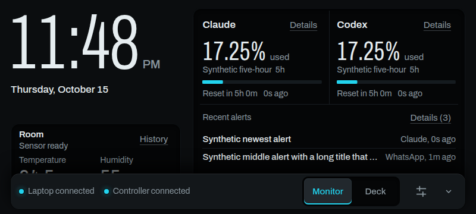
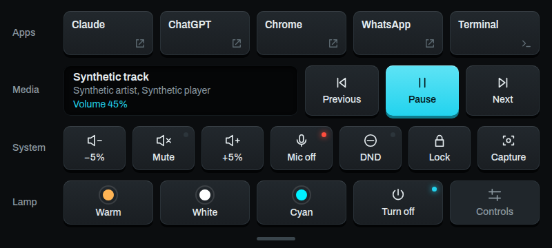
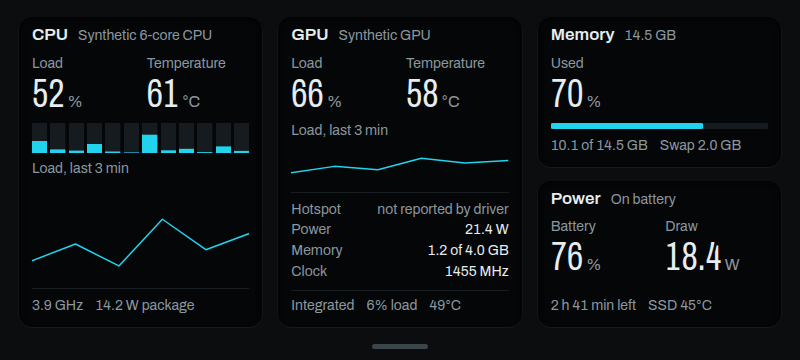

# LumenDock

Turn a spare Android phone into a desk display for your laptop. Over USB it shows your Claude and Codex usage limits, recent Claude/Codex/WhatsApp alerts, what is playing, and a deck of laptop keys. Over Wi-Fi it controls an ESP32 RGB lamp and reads the room's temperature and humidity.





*Screenshots use synthetic data.*

## What it does

**Monitor** is the glanceable screen:

- A large local clock and date that keep working without any connection.
- Room temperature and humidity from the lamp controller's sensor, with a history chart.
- Claude and Codex usage: percentage used, a bar that turns red near the limit, the window name, and when it resets. The full view lists every window as "5 hours" or "7 days". Claude usage comes from the Claude Code status line, or, if you opt in with `npm run claude-usage -- on`, from Anthropic every 3 minutes with no Claude session open.
- The newest alerts from Claude, Codex and WhatsApp (2 in landscape, 3 in portrait).

**Deck** is a grid of keys for the laptop and the lamp:

| Row | Keys |
|---|---|
| Apps | Claude, ChatGPT, Chrome, WhatsApp, Terminal |
| Media | Now playing (track, artist, player, volume), previous, play/pause, next |
| System | Volume down, mute, volume up, microphone mute, Do Not Disturb, lock screen, screenshot tool |
| Lamp | Warm, white and cyan presets, power, full light controls (9 modes, brightness, speed, sleep timer) |

Toggle keys carry a small status light: red while the mic or sound is muted, cyan while Do Not Disturb or the lamp is on.

**Laptop** shows the laptop's vitals: CPU load per thread, temperature, clock and package power with a three-minute load chart; GPU load, temperature, power, memory and clock (an idle hybrid-graphics GPU shows as asleep and is never woken to read it); memory and swap; and battery, power draw, time left and SSD temperature. Temperatures turn amber from 75°C and red from 85°C.



**Lamp signals.** The lamp pulses for a few seconds and then goes back to how it was:

- cyan when Claude or Codex sends an alert,
- green for a WhatsApp message,
- white when a used-up quota resets.

Each signal can be switched off, and quiet hours (11 PM to 8 AM) are on by default.

**Control bar.** A bar at the bottom switches between Monitor, Deck and Laptop, shows the laptop and lamp connection, and opens settings. It hides after eight seconds like an auto-hiding taskbar; tap the bottom edge to bring it back.

The layout adapts to landscape and portrait, honours the system text size and reduced motion, and keeps keys at least 44 px (the full-width bottom edge strip is the one thinner target).

## How it works

```
 Laptop (Linux, GNOME)                         Phone (Android 10+)                ESP32 lamp controller
 ┌───────────────────────────────┐   USB    ┌──────────────────────────┐  Wi-Fi  ┌──────────────────────┐
 │ LumenDock hub (Node)          │◀────────▶│ LumenDock app            │◀───────▶│ RGB_Controller       │
 │ 127.0.0.1:8765, loopback only │ adb      │ Kotlin host + WebView    │ its own │ firmware (separate   │
 │ · Codex usage (app-server)    │ reverse  │ React dashboard          │ access  │ project): LED strip, │
 │ · Claude usage (status line)  │          │ validates every message  │ point   │ temperature and      │
 │ · selected notifications      │          │ drives lamp + signals    │         │ humidity sensor      │
 │ · media, volume, mic, DND     │          └──────────────────────────┘         └──────────────────────┘
 │ · CPU, GPU, memory, power     │
 │ · fixed Deck actions          │
 └───────────────────────────────┘
```

The phone reaches the laptop only through `adb reverse` over the USB cable, so the hub never listens on a network. The phone joins the controller's own Wi-Fi access point for the lamp, and the two links work at the same time. Nothing goes to the cloud.

| Path | What lives there |
|---|---|
| `desktop/` | Laptop hub: collectors, pairing, the fixed Deck actions, setup tools (`doctor`, `connect`, service install) |
| `android/` | Android app: WebView host, USB and Wi-Fi clients, native pairing and Wi-Fi dialogs |
| `dashboard/` | The phone UI (React + Vite), bundled into the APK |
| `packages/protocol/` | Shared message schemas (Zod) and synthetic fixtures used by every side |
| `scripts/` | Build, packaging and the background service runner |
| `docs/` | Setup, testing, acceptance records and project history |

## Requirements

- **Laptop:** Linux with GNOME and PipeWire (developed on Ubuntu with GNOME 50), or Windows 10/11 ([docs/WINDOWS.md](docs/WINDOWS.md)). Node.js 24, `adb`. Claude Code and the Codex CLI are optional; each feeds its own usage card.
- **Phone:** Android 10 or later with USB debugging. Developed and used on a Redmi 9A (MIUI).
- **Lamp (optional):** an ESP32 running the RGB_Controller firmware, which provides the `Rgb_Controller` access point at `192.168.4.1`. Everything except the lamp and room readings works without it.

## Install

1. **Phone app.** Download `lumendock-<version>.apk` from the [latest release](https://github.com/Arcco-Chakraborty/lumendock/releases/latest) and check its SHA-256 against the release notes. Every release is signed with the same LumenDock key; its certificate SHA-256 is
   `59:5F:8A:A4:BE:43:BA:D2:CB:E5:32:AC:06:A9:E8:11:D0:B1:F8:EB:81:F4:D8:D6:8B:76:A1:1C:67:F6:39:33`.
2. **Laptop hub.** Easiest: download the desktop bundle for your system from the same release. On Windows, extract `lumendock-desktop-<version>-windows.zip` and run `Install.cmd`; on Ubuntu, extract `lumendock-desktop-<version>-linux.tar.gz`, run `npm ci --omit=dev --workspace @phone-monitor/desktop`, then `scripts/linux/install-desktop.sh`. Each bundle's `INSTALL.txt` has the steps. Or from source:
   ```sh
   git clone https://github.com/Arcco-Chakraborty/lumendock.git && cd lumendock
   npm ci
   npm run build
   npm run doctor
   ```
3. **Connect and pair.** Follow [docs/QUICKSTART.md](docs/QUICKSTART.md): install the APK over USB, start the USB link, pair with an 8-digit code, then join the lamp's Wi-Fi from the app's settings.

Day to day, one command runs the hub and the USB link in the background:

```sh
./phone-monitor.sh start     # also: status, logs, stop
```

On Windows, a desktop icon starts the hub and the USB link with a tray icon; nothing starts with Windows. See [docs/WINDOWS.md](docs/WINDOWS.md).

## Privacy and security

- The hub binds `127.0.0.1` only and is reached over the USB cable. Pairing needs an 8-digit code that is valid for 2 minutes and works once. The resulting token is stored with owner-only permissions on both sides.
- No accounts of its own and no model calls. Usage comes from the Codex CLI's local app-server and an opt-in Claude Code status line.
- Optional Claude usage polling (off by default) reads only the access token and expiry that Claude Code keeps on the laptop. The token is sent only to Anthropic's usage endpoint, and is never refreshed, stored, logged or sent to the phone.
- Notification capture is off until you allow specific apps. Only allowed alerts are kept, in memory, for 30 minutes.
- The phone can only trigger a fixed list of Deck actions. They run without a shell, and nothing the phone sends becomes a command.
- The lamp's Wi-Fi password stays in the app's private storage on the phone, with backups disabled.

## Building from source

The build uses a project-local toolchain and never changes the system Node or Java: Node 24.22.0, JDK 17 and Android SDK 36 under `~/.local/share/phone-monitor/toolchains`. See [docs/SETUP.md](docs/SETUP.md).

```sh
npm run build                       # protocol, hub and dashboard
node scripts/build.mjs              # Android tests, lint and a debug APK
node scripts/build.mjs --release    # signed release APK -> artifacts/lumendock-<version>.apk
npm run package                     # desktop tarball, manifest and SHA256SUMS in artifacts/
```

`--release` reads the signing key from a private properties file outside the repository (`LUMENDOCK_SIGNING`, default `~/.local/share/phone-monitor/signing/release.properties`). It then verifies the signature with `apksigner`.

## Tests

```sh
npm test               # protocol, hub and dashboard unit tests
npm run test:e2e       # production dashboard in headless Chrome at phone sizes
```

Android unit tests and lint run as part of `scripts/build.mjs`. The tests use fakes and synthetic fixtures only: they never pair a device, run a real Deck action, read real notifications or call a model. Details are in [docs/TESTING.md](docs/TESTING.md).

## Status and limitations

Version 1.1.0 is in daily use on a Redmi 9A with the RGB_Controller lamp. Known limits:

- Laptop features target Linux with GNOME, and Windows with the differences listed in [docs/WINDOWS.md](docs/WINDOWS.md). On Linux, the Deck's system keys rely on `wpctl`, `gsettings`, `loginctl` and the desktop screenshot portal. GNOME only allows its own tools to take silent screenshots, so the screenshot key opens the screenshot tool instead.
- Notifications are captured from the freedesktop `Notify` call. Apps that use GNOME's own notification API or the portal are not seen.
- An existing custom Claude Code status line is left untouched unless you attest it is compatible (see [docs/SETUP.md](docs/SETUP.md)).
- The phone app's package name is still `com.phonemonitor`, and the laptop config folder is `~/.config/phone-monitor`. These come from the project's original name and are kept so existing installs keep working.

See [CHANGELOG.md](CHANGELOG.md) for what changed in each release.

## License

[MIT](LICENSE). The bundled Archivo font is under the SIL Open Font License; see `dashboard/src/assets/fonts/ARCHIVO-OFL.txt`.
