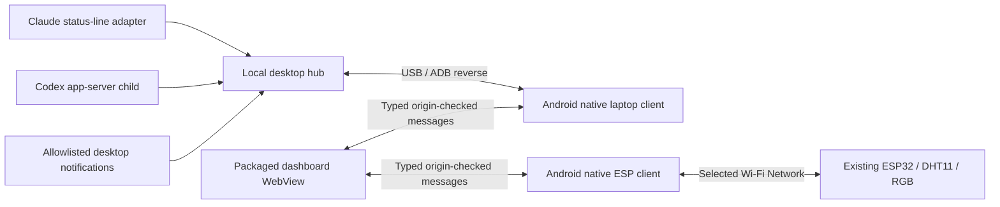

# Phone Monitor — System Design

Authority: [PRD](../../PRD.md). Date: 2026-10-14. This is the proposed architecture for plan review; files listed below are planned files, not existing implementation.

## Architecture and component boundaries



Three subprojects have independent deliverables and tests:

1. **Desktop hub:** normalized subscriptions/notifications through an authenticated loopback API; works with fixture clients without Android.
2. **Android companion:** trusted packaged UI host, pairing, USB client, and Wi-Fi-bound controller client; works with a diagnostic fixture UI before the dashboard is complete.
3. **Dashboard:** presentation and intent-only light controls through a typed device adapter; works in a browser with synthetic data without provider accounts/hardware.

Integration consumes their contracts; no component copies provider authentication or requires the desktop to join the ESP32 AP. Real hardware routing is tested as soon as the companion exists, before visual polish or release claims.

Repository units:

```text
packages/protocol/src/{schema.ts,index.ts}
packages/protocol/fixtures/{hub-ready.json,hub-unknown.json,esp-ready.json,esp-history.json}
desktop/src/{main.ts,server.ts,store.ts,pairing.ts,config.ts,adb.ts}
desktop/src/collectors/{claude.ts,codex.ts,notifications.ts}
desktop/src/claude/{wrapper.ts,install.ts}
desktop/test/{server,pairing,claude,codex,notifications,adb,installer}.test.ts
android/app/src/main/java/com/phonemonitor/{MainActivity,DashboardBridge,BridgeRouter,PairingStore,LaptopClient,EspClient,WifiSession,ControlQueue,SessionLifecycle}.kt
android/app/src/main/res/xml/network_security_config.xml
android/app/src/test/java/com/phonemonitor/{BridgeRouter,LaptopClient,EspClient,ControlQueue,SessionLifecycle}Test.kt
android/app/src/androidTest/java/com/phonemonitor/DashboardSecurityTest.kt
dashboard/src/{App.tsx,main.tsx,device.ts,store.ts,styles.css}
dashboard/src/components/{UsageCard,ClimateCard,LightCard,NotificationStrip,SettingsSheet}.tsx
dashboard/src/lib/{time.ts,lightIntent.ts}
dashboard/test/{device,time,lightIntent,render}.test.tsx
dashboard/e2e/dashboard.spec.ts
scripts/{doctor.mjs,build.mjs,connect.mjs,install-hub.mjs,uninstall-hub.mjs,package.mjs}
docs/{SETUP.md,TESTING.md,DEVICE_ACCEPTANCE.md}
artifacts/{phone-monitor-debug.apk,desktop-package.tar.gz,SHA256SUMS}
```

The controller alone owns contract changes. Task reviewers compare their task's diff with the common PRD; cross-task defects go into the integration ledger. The sibling firmware project is a read-only dependency of this release.

## Shared protocol

Define runtime schemas and exported TypeScript types in `packages/protocol`. Android uses matching DTO/parsers and the same JSON fixtures in unit/instrumentation tests. Reject unknown protocol versions. Unknown provider window/bucket labels remain valid, bounded strings; unknown bridge operations are invalid.

```ts
type Provider = "claude" | "codex";
type SourceState = "available" | "awaiting_data" | "auth_required" | "unsupported" | "error";
type UsageWindow = {
  bucketId: string; windowId: string; label: string;
  usedPercent: number | null; windowDurationMins: number | null;
  resetsAtEpochSec: number | null; reportedAtEpochMs: number | null;
};
type UsageSource = {
  provider: Provider; source: "claude_statusline" | "codex_app_server";
  state: SourceState; observedAtEpochMs: number | null;
  lastSuccessAtEpochMs: number | null; stale: boolean;
  windows: UsageWindow[]; errorCode: string | null;
};
type SelectedNotification = {
  id: string; appId: string; title: string; body: string;
  receivedAtEpochMs: number; expiresAtEpochMs: number;
};
type HubSnapshot = {
  v: 1; serverNowEpochMs: number;
  usage: { claude: UsageSource; codex: UsageSource };
  notifications: {
    state: "disabled" | "available" | "unavailable";
    errorCode: string | null; items: SelectedNotification[];
  };
};
type EspState = {
  power: boolean; hex: string; bright: number; mode: number; speed: number;
  timerSeconds: number; sensorOk: boolean;
  temperatureC: number | null; humidityPercent: number | null;
  uptimeSeconds: number;
};
type EspHistory = { intervalSeconds: number; temperatureC: (number | null)[]; humidityPercent: (number | null)[] };
type LinkSnapshot<T> = {
  state: "connecting" | "connected" | "disconnected" | "error";
  ageMs: number | null; stale: boolean; data: T | null; errorCode: string | null;
};
type LightPatch = { power?: boolean; hex?: string; bright?: number; mode?: number; speed?: number; timerMinutes?: number };
type CommandResult = {
  generation: number; kind: "state" | "timer";
  outcome: "pending" | "confirmed" | "unconfirmed" | "cancelled" | "superseded";
  state: EspState | null; errorCode: string | null;
};
type EspSnapshot = LinkSnapshot<EspState> & {
  commands: { state: CommandResult | null; timer: CommandResult | null };
};
type PairResult = { paired: boolean }; // Native internal result only.
type SetupState = {
  setupId: string | null; state: "idle" | "in_progress" | "succeeded" | "cancelled" | "failed";
  errorCode: string | null;
};
type SetupResult = { setupId: string; started: boolean };
type AppStatus = {
  paired: boolean; webViewSupported: boolean; wifiMode: "none" | "app_request" | "manual";
  setup: { hub: SetupState; esp: SetupState }; screenOn: boolean; brightness: number;
  nextCommandGeneration: number;
};
```

Native ageMs is elapsed monotonic time since receipt of the **exact cached data payload**, never since the latest bridge return. On JS receipt, anchor laptop time at data.serverNowEpochMs + link.ageMs, then advance by JS monotonic elapsed time. Data present with null age is invalid. Repeated failed polls returning the same payload therefore do not rewind the clock. The UI also recomputes source staleness and notification expiry as estimated laptop time advances, rather than trusting cached stale:false. After renderer recreation, the same payload plus its current native age provides a valid baseline; after native process recreation re-fetch, because its monotonic cache is not persisted. Without any sample, countdown is unknown.

Bounded inputs: 16 KiB bridge request; 256 KiB hub response; 64 KiB ESP response; 256 KiB Codex JSONL message; 256 KiB Claude monitoring buffer (prior-command passthrough is not truncated). Snapshot reserves up to two Claude windows and up to 62 Codex windows, no more than 64 total, and 100 retained notifications. Excess Codex windows produce unsupported/SOURCE_CAPACITY_EXCEEDED, retaining last good data as stale; with no prior sample expose an empty unsupported source. Never silently truncate and claim completeness. Strings: bucket/window identifiers 80 characters, window labels 80, app labels 80, titles 100, bodies 280. Preserve Unicode code points. If serialized notification output would exceed the hub byte budget, omit oldest notifications from that response and keep the newest complete records. Malformed oversized input never replaces a good snapshot.

Bridge request/reply:

```ts
type BridgeOp = "hub.snapshot" | "esp.state" | "esp.history" | "esp.set"
  | "app.status" | "app.setupHub" | "app.connectEsp" | "app.openWifiSettings"
  | "app.setScreenOn" | "app.setBrightness";
type BridgeRequest = { v: 1; id: string; op: BridgeOp; args: Record<string, unknown> };
type BridgeReply = { v: 1; id: string; ok: boolean; data?: unknown;
  error?: { code: string; retryable: boolean } };
```

`hub.snapshot`/`esp.history` return `LinkSnapshot<T>`; `esp.state` returns `EspSnapshot`, including the most recent ordinary/timer outcomes so a later reconciliation reaches the UI. `esp.set` takes `{patch:LightPatch,generation:number}` with a nonempty patch and positive safe-integer generation, and returns `CommandResult`. A patch containing timerMinutes plus any other field is rejected. A timed-out command is unconfirmed with COMMAND_UNCONFIRMED and retains its generation; transport failure is not a fabricated confirmation.

Freeze all app operation schemas in D1:

| Operation | Exact args | Exact reply data |
|---|---|---|
| `app.status` | `{}` | `AppStatus` |
| `app.setupHub` | `{}` | `SetupResult` |
| `app.connectEsp` | `{}` | `SetupResult` |
| `app.openWifiSettings` | `{}` | `{opened:boolean}` |
| `app.setScreenOn` | `{enabled:boolean}` | `{screenOn:boolean,brightness:number}` |
| `app.setBrightness` | `{value:number}` (finite 0.1–1.0) | `{screenOn:boolean,brightness:number}` |

Setup acknowledges within one second after opening one native flow; the ten-second bridge deadline applies to that acknowledgment, never to human code entry/OS approval. One active setup flow exists across the app. Duplicate taps for the same flow return its setupId and started:false; a competing flow returns SETUP_BUSY. Native completion/cancellation/expiry updates typed app.status; credentials never travel through JS. The dashboard polls status every two seconds only while setup is in progress. Native setup persists across WebView renderer recreation while its Activity remains alive; view teardown rejects JS requests but does not erase successful pairing. Activity/session end cancels unfinished UI flows and releases owned network requests. Recreated JS reads status rather than opening a duplicate dialog.

Requests have a ten-second UI deadline and a bounded pending map; teardown rejects pending promises. Reject unexpected args for every operation. An unknown setupId outcome is never assumed successful. AppStatus.nextCommandGeneration supplies a native-owned generation floor: UI reads it before enabling writes, increments from it, and renderer recreation re-reads it. Native rejects reused/below-floor generations and uses a Long constrained to JS safe integers; old native outcomes cannot collide with a new view's IDs. Native process recreation clears pending work/cache before resetting its counter.

Codes are fixed enums such as `USB_UNAVAILABLE`, `AUTH_REQUIRED`, `PAIRING_EXPIRED`, `WIFI_UNAVAILABLE`, `SENSOR_UNAVAILABLE`, `BAD_PAYLOAD`, `UNSUPPORTED_WEBVIEW`, `COMMAND_UNCONFIRMED`, and `NOTIFICATION_MONITOR_DENIED`. Never return an exception stack, raw subprocess stderr, or arbitrary provider error text.

## Desktop hub specification

### API and pairing

Fastify binds `127.0.0.1:8765`; reject unexpected Host and any browser Origin header. All non-health responses are no-store. Health returns only `{v:1,status:"ok"}`. `GET /v1/snapshot` requires `Authorization: Bearer <phone-token>` and returns a cached/computed snapshot; it never triggers inference.

`POST /v1/pair` accepts only JSON `{code:string}` when the hub was explicitly started with `--pair`. Generate the eight-digit code cryptographically, print it to the local foreground setup terminal, and expire after 120 seconds or five failed requests. Success issues a 32-byte random device token, persists it privately, returns it once to the native client, and closes pairing. Existing phone token stays valid until replacement pairing succeeds. A concurrent second success is impossible. Pairing with a running normal hub requires stopping this product's own service and starting setup mode; never kill unrelated listeners on port conflict.

Every request body uses a byte limit and strict schema. Tokens are compared safely, never echoed, and redacted from logs. No CORS, universal command endpoint, or remote bind option. `store.ts` computes staleness/expiry at read time and retains last good observations on failures. Phone activity is established only by authenticated snapshot requests; upstream Codex polling slows after ten seconds without them.

### Claude subproject

The opt-in installer wraps only the user statusLine field. Read original settings once; backup bytes privately; preserve existing type, padding, and refreshInterval semantics; replace only command with a safely quoted exec of the selected absolute Node executable and wrapper. Save the prior command as data. Its shell is an explicit installation prerequisite: require a declared/verified absolute --previous-shell for an existing command; do not infer it from a login shell or SHELL. If compatibility is unknown, leave the current statusLine unchanged and explain the requirement. No prior command needs this choice.

Execute the saved command in that declared non-login shell with same stdin/cwd/environment and unchanged stdout/stderr/exit status. Monitoring capture buffers at most 256 KiB, but passthrough delivers the unchanged entire stdin stream even on capture overflow. Handle backpressure and normal early EPIPE when the prior command exits without draining stdin; capture may still drain bounded input and must not crash or suppress output. Spawn only the wrapper's child in an owned process group; on normal Claude cancellation/SIGTERM/SIGINT stop capture, terminate that group, wait at most 500 ms, escalate if needed, reap, and propagate signal/exit semantics. Never signal unrelated groups. Uninterceptable OS hard kill cannot run cleanup; verify the installed Claude's cancellation path supports the ownership model before enabling passthrough. Collector failures do not contaminate stdout or convert a previous nonzero exit to success. A wrapper with no prior command prints a minimal model label.

Whitelist subscription fields; local private metadata includes a session discriminator, separately tracked API-response signature, and genuine-report ordinal; none is exported. A changed API-response signature or changed **present, non-expiry** supplied quota/reset can advance report time. Merely removing a window whose reset passed, or rerunning equal input, cannot. Preserve expired last-known windows and their original reset/reportedAtEpochMs until a substantive supplied report replaces them; a new weekly report does not refresh a retained expired five-hour row. Never-observed windows remain unknown. A first captured cached sample with no response evidence is displayed as first-seen/stale with null known report time until a substantive report occurs.

Use bounded per-session state (32 entries, 24-hour inactivity expiry). Under a private observation-store lock, assign each genuine report a persisted monotonically increasing ordinal. The public source selects the greatest genuine ordinal; an unchanged old session's later timer cannot overwrite it. Ties preserve the existing winner. On hub restart, restore ordinal/observation time without using file reload time as freshness. If there is no genuine report yet, choose the latest first-seen sample but retain unknown report age/stale state. Expiry-only changes cannot erase a winning source's last usage.

Atomic mode-0600 last-observation files let the wrapper operate while the hub is stopped. The hub watches/reloads validated records and does not read transcripts. Installation into a settings file uses an advisory lock and atomic same-directory rename; preserve unrelated fields and mode. Reinstall is idempotent. Uninstall restores the original status-line field only if the currently installed field is still owned by this installer. If the user changed it, explain the conflict and retain the backup. Do not restore the entire old settings file over new edits. Project/managed overrides are detected/documented as capability limitations rather than overwritten.

### Codex subproject

Spawn `codex` with `['app-server','--listen','stdio://']`, without a shell. Send `initialize` with named client info, wait for its response, send `initialized`, then inspect `account/read` with `refreshToken:false` and `account/rateLimits/read`. Correlate IDs; bound line length and request deadlines; sanitize errors. Normal Codex-managed auth is allowed to refresh itself, but the collector never invokes login/logout or reads auth files/keyrings.

Prefer `rateLimitsByLimitId`; support legacy `rateLimits`. Normalize `primary`/`secondary` windows per bucket, preserving actual `windowDurationMins`, numeric usage, and null/missing fields. Update notifications merge buckets without discarding others; periodic full reads reconcile missing buckets. A full read advances `lastSuccessAtEpochMs`; an update advances observation time but does not pretend a full reconciliation occurred.

One child and one quota request at a time. Retry crashes with 1/2/4/8/16/32/60-second delays. Ten-second handshake/request deadlines; stalled initialization restarts safely. Auth-required pauses fast polling and allows explicit retry/slow auth checks. Exiting the hub closes stdin, sends graceful termination, and force-stops only its own child after two seconds. No sessions, turns, or model prompts are created by this collector.

### Notification subproject

Use GNOME's session D-Bus notification traffic through a separate `busctl --user --json=short --no-pager monitor` child. Match future `org.freedesktop.Notifications.Notify` method calls, with allowlisted `arg0` app labels. Parse actual typed JSON fixtures; do not parse human-formatted monitor text. App labels accept printable ASCII `[A-Za-z0-9 _.:-]{1,80}` so match rules cannot be injected. Start no monitor when the allowlist is empty.

Permissions may deny BecomeMonitor. Report unavailable and leave other sources running; never elevate privileges, change bus policy, or replace the notification daemon. The app is a display-only event feed; exact server notification replacement IDs/actions are not implemented. Generate local event IDs; deduplicate identical selected events within two seconds; cap 100 records/30-minute TTL; plaintext only; no disk history. Monitor exit/restart follows bounded backoff and reap/cleanup rules.

## Android companion specification

`MainActivity` hosts a WebView and small native setup dialogs. Bundle production dashboard assets with `WebViewAssetLoader`. Register `phoneMonitor` using `WebViewCompat.addWebMessageListener` only if `WEB_MESSAGE_LISTENER` is supported; accept exact HTTPS appassets origin and main frame only. Reply with `JavaScriptReplyProxy.postMessage` containing serialized data, not executable JS. No legacy unrestricted interface fallback in this release.

Block remote requests/navigation and deny popup/download handlers; set safe content/file/mixed-content options and a restrictive packaged CSP (`default-src 'self'; script-src 'self'; style-src 'self'; img-src 'self' data:; connect-src 'none'; frame-src 'none'; object-src 'none'; base-uri 'none'`). Avoid inline scripts/styles or apply an explicit hash/nonce design; do not weaken CSP to make generated output work. Disable WebView debugging in release builds; personal debug build may enable it only for development.

The native bridge is a router of typed actions, not a generic network proxy. It does I/O off the main thread, schedules replies on the main thread, and scopes jobs to the current dashboard session. Hold no Activity reference in long-lived jobs. Implement `onRenderProcessGone` by tearing down old bridge/jobs and recreating a fresh WebView with a useful recovery state.

`LaptopClient` uses ordinary unbound HTTP to `127.0.0.1:8765`. `PairingStore` keeps the token privately and disables backup. Handle 401 by clearing invalid cached authorization state, preserving data as stale, and asking for pairing; never retry invalid credentials forever. Tokens exist only inside native request construction.

`WifiSession` supports Android 10+ app-specific Wi-Fi request for native-configured SSID/credentials, with TRANSPORT_WIFI and no INTERNET requirement. Request required OS permissions from a visible user action: ACCESS_FINE_LOCATION through API 32 (manifest maxSdkVersion 32) and NEARBY_WIFI_DEVICES from API 33 with neverForLocation, since this product does not derive physical location or scan for it. Handle location-services-off where the older API requires it. Handle denial/unavailable/loss distinctly and offer manual settings fallback. Keep one request/callback while the foreground session needs it; do not repeatedly reprompt after denial or cancel merely because the permission/approval UI paused the Activity. Actual background/end-session releases it; process death requires reestablishing it on return.

`EspClient` uses `Network.openConnection(..., Proxy.NO_PROXY)` on the selected Wi-Fi Network, never `bindProcessToNetwork`. On loss cancel reads/writes and discard network handles. Recreate after onAvailable/capabilities/link-properties callbacks; no VALIDATED/internet condition. Manual mode observes available Wi-Fi networks and verifies the expected controller response rather than assuming default internet routing is appropriate.

Map firmware `{power,r,g,b,bright,mode,speed,timer,ok,t,h,up}` to `EspState`. Validate numeric bounds, booleans encoded as 0/1, finite/null climate, six-digit uppercase RGB. Ignore additional known-firmware fields but never accept a generic response as state. History is `{iv,t:[],h:[]}`; verify equal array lengths ≤120 and a positive interval. Use elapsed sample offsets, since firmware has no absolute sample timestamps.

All controller operations are explicit values via encoded GET query parameters to the existing API. ControlQueue owns command reconciliation. Unsent ordinary patches merge per field with latest touched values; untouched fields are not resent. Adjacent ordinary operations may merge, but not across a timer barrier. Queue at most four unsent units plus one in flight; reject excess discrete actions with QUEUE_FULL rather than losing one. Superseded merged generations settle their bridge replies as superseded so callbacks do not leak. Timer patches contain timerMinutes only and form ordered once-only barriers. Explicit power-off cancels unsent timer barriers; a subsequent confirmed power-off clears the timer marker, without pretending to cancel an already dispatched timer before that confirmation.

An ordinary timeout triggers a state read begun **after** the relevant write dispatch. Compare only touched ordinary fields, keep generation/dispatch sequence, and ignore earlier polls as reconciliation evidence. Matching state sets that generation confirmed; mismatch or another read failure keeps it unconfirmed. No command is automatically resent: an explicit UI retry creates a new generation after a read. Timer responses can confirm their own operation; a later timer duration alone cannot prove completion, so a lost timer response remains uncertain. Store latest separate ordinary/timer outcomes in EspSnapshot.commands, preserving a timer's uncertainty while ordinary writes proceed. On link loss/end-session cancel unsent units and clear outstanding callbacks; reconnect reads state without replay. External physical-button changes appear on the next state read without clearing newer desired intent.

Foreground flag and app-window brightness require no global device-policy change. Do not request root, Device Administrator, boot receivers, foreground service permissions, or a partial wakelock.

## Dashboard specification

Vite builds React into static assets with relative paths, an ES2018 target, system fonts, and no server requirement. `DeviceAdapter` separates native message transport from browser fixtures:

```ts
interface DeviceAdapter {
  request<T>(op: BridgeOp, args?: Record<string, unknown>): Promise<T>;
  dispose(): void;
}
```

Browser development uses an explicit mock adapter; packaged production assets never silently fall back to simulated live data. A small synthetic demo route is development-only and labelled clearly.

`store.ts` keeps hub and ESP link states separately. Poll only when visible; skip while that operation is already in flight. On resume fetch fresh snapshots rather than replaying accumulated timers. Polling failures preserve data/intent and update connectivity state. Anchor cached hub time with serverNowEpochMs plus its native ageMs; recompute source stale thresholds and notification expiry as the monotonic clock advances. Use an injected clock for tests and tick only displayed seconds, not animation frames.

Usage cards render nullable windows and server labels, clamp only graphic fill, and calculate countdown via sampled laptop time. Lighting view maintains desired state separately from confirmed state; per-field merges preserve queued ordinary changes, timers form separate barriers, and a maximum-four-unit intent queue prevents loss of discrete commands. Native generation outcomes in command replies/esp.state determine pending/unconfirmed markers; old outcomes cannot clear newer desired intent. Notifications are escaped React text and expire locally using sampled laptop time. No dangerouslySetInnerHTML is allowed for data.

Chart is lightweight SVG with gaps for missing samples and at most 120 points. Rebuild only when history changes. Preserve input focus and scroll while snapshots refresh. CSS layout has readable secondary sheets instead of shrinking everything into one screen.

## Recovery and lifecycle

| Event | Required response |
|---|---|
| USB cable disconnected | Mark laptop link disconnected; retain labelled data; ESP continues |
| USB reauthorized/reconnected | Selected-device launcher restores reverse mapping; native client backs off/retries |
| Laptop sleeps/hub restarts | Treat as link failure; token persists; reconnect without re-pairing unless token revoked |
| Codex child crashes/auth unavailable | Only Codex changes state; other cards stay live; bounded restart or setup guidance |
| Claude has no active response yet | Awaiting data; don't launch a prompt to manufacture a report |
| Wi-Fi denied/wrong password | Show setup state; no repeated approval prompts; manual fallback available |
| AP disappears/default network changes | Cancel obsolete ESP requests; discard Network; reacquire without rerouting USB |
| Sensor fails but HTTP works | Sensor indicator lost, old climate labelled, controls still work |
| App background or WebView renderer dies | Stop view polling, clear pending callbacks, release ended sessions, recreate on return |
| Clock adjusted on phone/laptop | Use monotonic time between new server samples; recompute offset at next hub response |
| Light command completion unknown | Retain last confirmation; mark unconfirmed; reconcile safely; no timer replay |

## Packaging and validation

Doctor records selected device model, API, release, MIUI build, WebView provider/version, and viewport without exporting phone serial or account identities in a shared report. If no authorized device is attached, produce software evidence and mark physical rows unrun. Read-only ADB discovery does not change settings.

Build Node/frontend and Android separately, then copy the built dashboard into Android assets through a reproducible build step. Production assets contain no dev-server URL. Generate a checksum manifest for APK/desktop bundle. APK install is an explicit setup step; runtime startup never reinstalls it or modifies phone settings.

Tests: schemas/parser/clock/intent tests, temp-directory configuration installation tests, fake JSON-RPC children, fake ADB runner, synthetic busctl stream, Android JVM/instrumentation tests, Playwright view/layout tests, and the physical acceptance matrix in the PRD. Mock passing results cannot substitute for real routing, strip response, or MIUI lifecycle checks.

Final review package contains the PRD, design, task plans, complete change diff/file manifest, progress ledger, per-task verification evidence, screenshots/build sizes, device acceptance report, and known limitations. The final reviewer is explicitly `gpt-6-astra` with `high` reasoning effort. Address blocking findings, re-run affected checks, and obtain a scoped re-review. Do not create a GitHub repository, publish an APK/site, push, or merge as a side effect of planning/building.

## Decisions and alternatives

- Native transports plus a packaged web UI fit the separate USB/Wi-Fi topology and avoid changing firmware for CORS.
- Polling cached snapshots is sufficient for this desk display; SSE/WebSocket and a background Android service would add lifecycle work without a first-release requirement.
- Provider tools remain the authentication authority; no unofficial OAuth endpoint or browser scraping is part of the design.
- A direct Chrome-only dashboard can be a later variant if controller CORS/local-network requirements are deliberately addressed. It is not the release baseline.
- Desktop-to-ESP over laptop Wi-Fi would consume the laptop's connection and change the user's desired topology; keep that traffic on the phone.
- Broad kiosk/boot automation is deferred until ordinary foreground operation passes Redmi acceptance.
